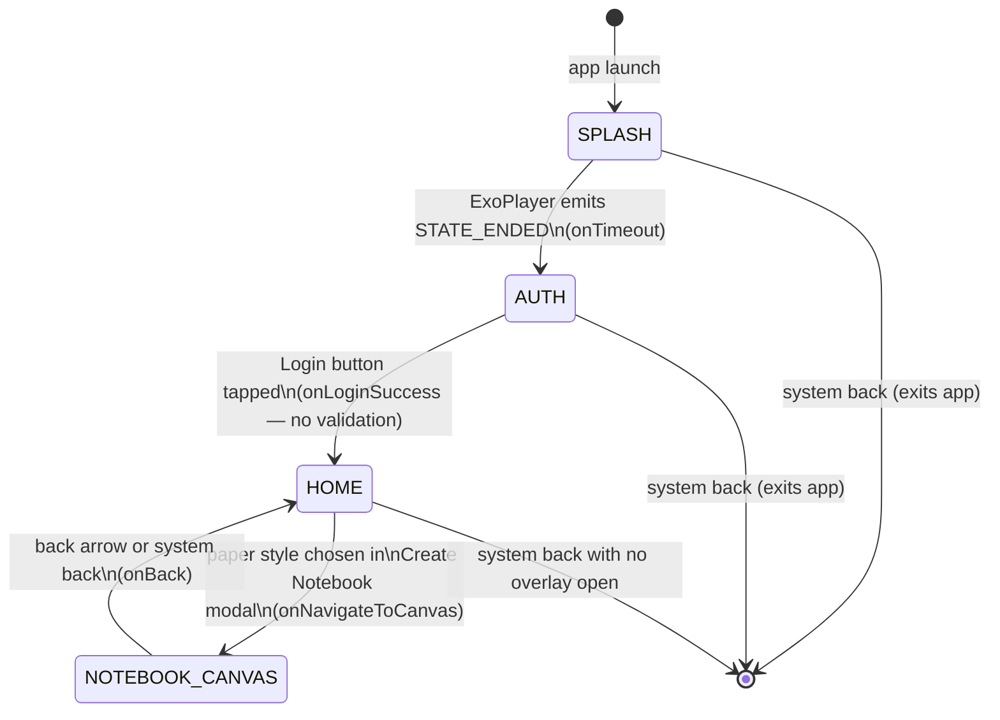
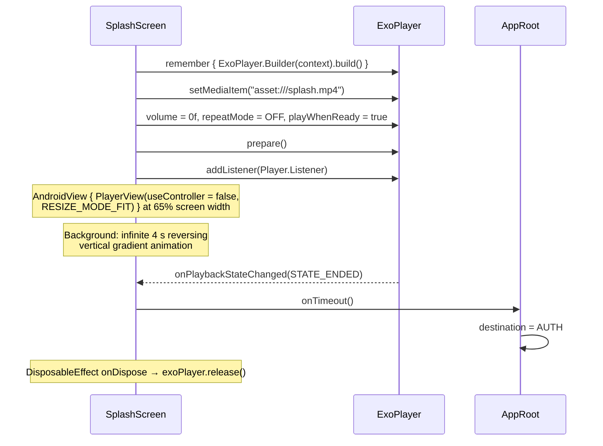
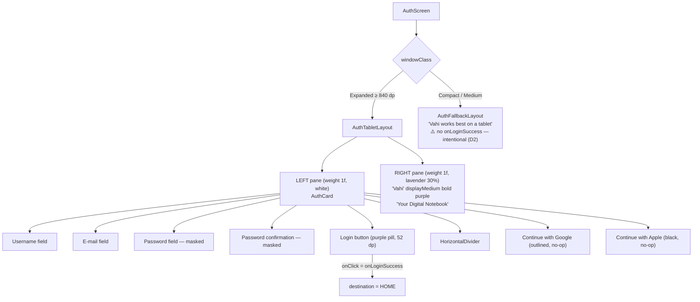
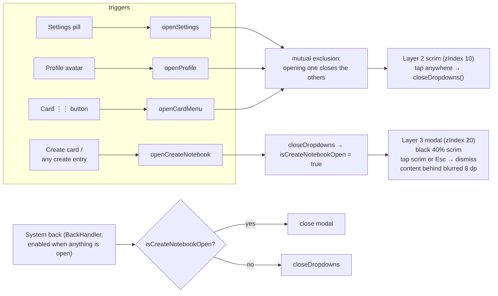
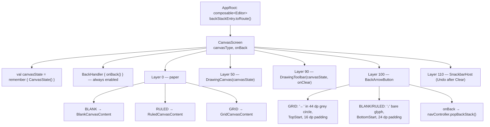

# 03 — Application Flow

## The whole app in one diagram



Four destinations, three forward transitions, one backward transition. That is the entire navigation graph — the *state names* above are unchanged by the Session 6 navigation rewrite, only the implementation underneath them (see [`02-architecture.md`](02-architecture.md) §Navigation).

## Startup sequence

```
Android launcher
  → MainActivity.onCreate()
      → enableEdgeToEdge()
      → setContent {
            VahiTheme {                 // dynamicColor = false (decision D4, Session 4) —
                AppRoot()               // always the hand-authored Vahi light/dark scheme
            }
        }
  → AppRoot: NavHost(startDestination = Splash)   // Session 6 — was `destination = SPLASH`
  → SplashScreen composes
```

`MainActivity` is intentionally trivial — 25 lines, no logic beyond hosting Compose. Its KDoc says so explicitly: *"This activity only hosts the Compose UI via setContent. All UI logic is delegated to AppRoot."*

## Step 1 — Splash

**File:** `ui/screens/SplashScreen.kt`



Key points:

- The transition is driven **entirely by video playback completing** — there is no timer fallback. The duration of `assets/splash.mp4` (800 KB) is the duration of the splash.
- Audio is muted (`volume = 0f`) and the video plays once (`REPEAT_MODE_OFF`).
- The player is correctly released in `DisposableEffect(Unit) { onDispose { ... } }`.
- The background is not static: `rememberInfiniteTransition` drives a 4-second `LinearEasing` reversing float, which modulates the alpha of a three-stop off-white vertical gradient (`#F8F6F4` → `#FAF8F6` → `#F5F3F1`).
- ⚠️ **Failure mode:** if the media fails to load, `STATE_ENDED` never fires and the app is stuck on the splash forever. There is no `onPlayerError` handling and no timeout.

## Step 2 — Auth

**File:** `ui/screens/AuthScreen.kt`



Key points:

- The four text fields are backed by local `remember { mutableStateOf("") }` values. **Their contents are never read.** `onClick = onLoginSuccess` is passed the callback directly — no validation, no comparison of password vs. confirmation, no network call.
- One combined form serves both sign-up and sign-in — there is no mode toggle. Username + email + password + confirmation reads as *registration*, but the button says *Login*.
- Google and Apple buttons have `onClick = {}`.
- The Google logo is the letter `G` styled in `#4285F4`; the Apple button's icon slot contains an empty string.
- All fields are built by a shared private `VahiStyledField` composable: a label above a 28 dp-radius `OutlinedTextField` with lavender borders (`VahiInputBorder` → `VahiInputBorderFocused` on focus) and a purple cursor.
- ⚠️ **`AuthFallbackLayout` takes no parameters and provides no path forward.** On any device narrower than 840 dp the app is unusable past this point.

## Step 3 — Home (the notebook library)

**File:** `ui/screens/HomeScreen.kt` (982 lines — the largest file in the project)

### Layer structure

`HomeScreen` is a `Box` with three stacked layers:

```
zIndex 20   CreateNotebookOverlay      ← full-screen modal, when isCreateNotebookOpen
zIndex 10   Dropdown scrim + one of {CardContextMenu, SettingsOverlay, ProfileOverlay}
zIndex  0   HomeContent                ← blurred 8 dp while the modal is open
```

### HomeContent, top to bottom

| Section | Composable | Contents |
|---|---|---|
| Top bar | `TopBar` | `vahi_logo` image (48 dp tall) · spacer · **Upgrade** dark pill · **Settings** light pill with gear icon · 44 dp circular profile avatar (beige, 🐦 emoji) |
| Filters | `FiltersRow` | **All** (selected, pill background) · *Pinned notes* · *Imported Books* — all three currently no-ops |
| Toolbar | `ToolbarRow` | 280 dp search field ("Search notebooks…", non-functional — it's a `Text`, not a `TextField`) · spacer · three view-mode toggle boxes (✓ / ⊞ / ≡) · **Most recent** sort dropdown · blue **Import** pill |
| Grid | `NotebookGrid` | `LazyVerticalGrid(columns = Fixed(3))`, 24 dp gaps. First item is always `CreateNotebookCard`; then the notebook cards. |

### The notebook data

Hardcoded inside `NotebookGrid`:

```kotlin
val notebooks = listOf(
    Notebook("1", "Maths notes",     "Created 4 jan 2025",  Color(0xFFBABEFF)),
    Notebook("2", "Python Problems", "Created 23 dec 2025", Color(0xFFD3C3C3))
)
```

Each `NotebookCard` is 260 × 200 dp, 16 dp radius, filled with its colour, and shows: a 40 dp translucent icon tile (emoji picked by title keyword — 🧮 for "Maths", 💻 for "Python", 📓 otherwise), a `⋮⋮` overflow button top-right, and title + created date bottom-left.

`CreateNotebookCard` is the same size in `VahiCreateCardBg` grey with a 56 dp lavender circle containing a `+`.

### Overlay interaction model



The three dropdowns are anchored using positions captured via `onGloballyPositioned { it.positionInRoot() }` on the trigger, then applied as top padding on a `TopEnd`-aligned box.

⚠️ **Unit bug:** `positionInRoot()` returns **pixels**, but the value is used as **dp** — `padding(top = (settingsButtonPosition.y + 48).dp)`. On any device with density ≠ 1.0 the dropdowns are offset proportionally to screen density. Only the Y coordinate is used at all; X is discarded and everything is right-aligned, so the card menu appears at the screen edge regardless of which card it belongs to.

### Menu contents (all items currently just dismiss)

| Overlay | Width | Items |
|---|---|---|
| `CardContextMenu` | 180 dp | delete, edit, share, pin, lock |
| `SettingsOverlay` | 260 dp | Profile, Preferences, Help, Logout |
| `ProfileOverlay` | 240 dp | Profile, Account, Notifications, Upgrade to Plus, Logout |

Each row is 44 dp with a 20 dp grey square placeholder where an icon will go.

### The Create Notebook modal

`CreateNotebookOverlay` — a 680 dp-wide white `Surface`, 16 dp radius, 8 dp elevation, centred over a 40 %-black scrim, holding the heading *"Select the style that fits your needs"* and a 2 × 2 grid of `CreateNotebookOption` cards (120 dp tall, each with a glyph tile: □ ≡ ⊞ ↓).

Dismissal works three ways: tap the scrim, press **Escape** (via `onPreviewKeyEvent` on a `FocusRequester` that grabs focus in a `LaunchedEffect`), or system back.

Selection dispatch:

```kotlin
when (option) {
    "Blank"      -> onNavigateToCanvas(CanvasType.BLANK)   // was NotebookType before Session 6
    "Ruled"      -> onNavigateToCanvas(CanvasType.RULED)
    "Grid"       -> onNavigateToCanvas(CanvasType.GRID)
    "Import PDF" -> { /* Import handled separately */ }   // ← no-op
}
```

Note that options are dispatched by **string literal**, not by an enum — a fragility worth fixing (unrelated to the `NotebookType`→`CanvasType` change above; still open).

## Step 4 — Canvas

**Files:** `CanvasScaffold.kt` → one of `BlankCanvas.kt` / `RuledCanvas.kt` / `GridCanvas.kt`, plus `components/drawing/`. (Through Session 5 this was reached via a `NotebookCanvasScreen.kt` adapter; deleted in Session 6 — see [`02-architecture.md`](02-architecture.md) §Navigation.)



The route argument (`editor.canvasType`) arrives via `backStackEntry.toRoute<Editor>()` — see [`02-architecture.md`](02-architecture.md) §Navigation for the full route definitions.

### The three paper styles

| Style | Implementation |
|---|---|
| **Blank** | A white `Box` filling the screen. Nothing else. |
| **Ruled** | White background + a `Canvas` drawing **vertical** lines every 32 dp in `#D0D8E0` at 1 px width, full height. (Note: vertical, not the horizontal ruling the "Lined pages for writing" description implies.) |
| **Grid** | White background wrapped in `verticalScroll` + `horizontalScroll`, containing a **4000 dp × 4000 dp** `Canvas` that draws a dot lattice: 2 px-radius `#D0D0D0` circles spaced 24 px apart. |

⚠️ The grid's scroll modifiers cannot fire, because `DrawingCanvas` above it consumes the pointer events.

### Drawing

Once on any canvas, pointer input goes to `DrawingCanvas`, which starts / continues / finishes strokes in `CanvasState` and repaints on every change. `activeTool` defaults to `PEN`.

✅ **A toolbar exists** (`DrawingToolbar.kt`, added Session 4, fixed Session 6 — this paragraph was stale, predating both). A floating left-edge rail lets the user change `activeTool`, `strokeColor` and `strokeWidth`, and calls `undo()`, `redo()` and `clearAll()` (the last now snapshot-and-undoable, see [`09-project-status.md`](09-project-status.md) bug #13). `cancelStroke()` still has no caller anywhere — no gesture maps to it yet. See [`05-drawing-engine.md`](05-drawing-engine.md).

## Callback contract summary

The complete set of cross-screen callbacks. **Rewritten for Session 6:** `AppRoot`'s "response" column used to be a `destination = X` assignment; it is now a `NavController` call, per [`02-architecture.md`](02-architecture.md) §Navigation.

| Screen | Parameter | Signature | Fired when | AppRoot's response |
|---|---|---|---|---|
| `SplashScreen` | `onTimeout` | `() -> Unit` | ExoPlayer reaches `STATE_ENDED` | `navController.navigate(Auth) { popUpTo(Splash) { inclusive = true } }` |
| `AuthScreen` | `onLoginSuccess` | `() -> Unit` | Login button clicked | `navController.navigate(Library) { popUpTo(Auth) { inclusive = true } }` |
| `HomeScreen` | `onNavigateToCanvas` | `(CanvasType) -> Unit` | A paper style is chosen in the modal | `navController.navigate(Editor(canvasType))` |
| `CanvasScreen` | `onBack` | `() -> Unit` | Back arrow or system back | `navController.popBackStack()` |
